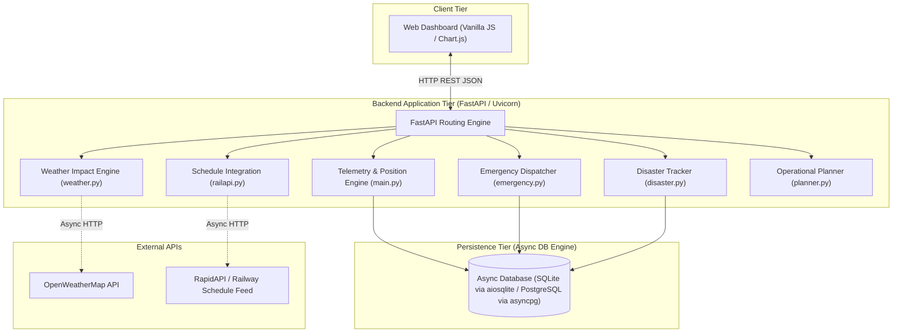

# 🚆 AlphaRail — Railway Operations & Telemetry Digital Twin

<p align="center">
  
  
  
  
  
  
  
</p>

---

## 📌 Executive Overview

**AlphaRail** is an operational digital twin prototype and telemetry dashboard engineered to monitor, simulate, and visualize railway operations across primary Indian railway corridors (e.g. Howrah – New Delhi, Patna – New Delhi). Built with high-performance asynchronous Python (**FastAPI** and **SQLAlchemy AsyncIO**), AlphaRail provides:

1. **Live Corridor Telemetry Simulation:** Tracking relative train positions, headway separation, and scheduled vs. estimated station arrivals.
2. **Environmental Risk Assessment:** Integrating real-time meteorological metrics via OpenWeatherMap to calculate weather hazard indices (e.g., fog visibility, torrential rainfall, extreme heat).
3. **Emergency Incident Dispatch:** Rapid reporting and logging of passenger emergencies, mechanical alerts, and route disruptions.
4. **Interactive Operations Dashboard:** Single-page web console displaying active corridors, fleet health KPIs, interactive charts, and station boards.

> [!IMPORTANT]
> **Digital Twin Prototype vs. Physical Safety Control:** AlphaRail is an engineering prototype designed for operational visualization, dispatch modeling, and telemetry simulation. It is **not** integrated into physical railway safety interlocking, automatic train protection systems (such as Kavach), or hardware signalling controls.

---

## 🏗️ System Architecture & Data Flow

AlphaRail decouples high-throughput async API endpoints from external meteorological and third-party railway feeds:



---

## 🔌 Verified REST API Reference

All endpoints return JSON responses and support cross-origin requests (CORS enabled):

| HTTP Method | Route | Description | Request Parameters / Payload |
|---|---|---|---|
| `GET` | `/` | Health check and system readiness probe | None |
| `GET` | `/api/train/{train_no}` | Retrieve metadata, route, and status for a specific train | Path parameter: `train_no` (e.g. `12301`) |
| `GET` | `/api/trains_between` | Query trains operating between origin and destination | Query params: `origin`, `destination` |
| `GET` | `/api/schedule/{train_no}` | Retrieve schedule timetable and station halt timings | Path parameter: `train_no` |
| `GET` | `/api/routes` | Route-wise real-time position vectors and track segments | None |
| `GET` | `/api/metrics` | Dashboard KPI summary (active trains, emergencies, alerts) | None |
| `GET` | `/api/weather/{city}` | Meteorological assessment and operational delay index | Path parameter: `city` (e.g. `Kolkata`, `Delhi`) |
| `POST` | `/api/emergency` | Log an urgent passenger, medical, or security incident | Body: `{"description": string}` |
| `POST` | `/api/query` | Submit passenger inquiries and operational messages | Body: `{"train_no": string, "subject": string, "message": string}` |

---

## 📂 Repository Layout

```
AlphaRail/
├── README.md                          # Master project documentation
├── STARTUP.md                         # Detailed startup guide
├── docs/                              # Technical documentation
│   └── INTERVIEW_PREP.md              # 15 technical interview questions & answers
├── backend/                           # FastAPI async service
│   ├── main.py                        # Application entrypoint & REST routes
│   ├── database.py                    # SQLAlchemy async session & engine lifecycle
│   ├── models.py                      # SQLAlchemy ORM declarative models
│   ├── weather.py                     # OpenWeatherMap client & hazard index
│   ├── railapi.py                     # Schedule extraction & RapidAPI client
│   ├── emergency.py                   # Incident logging & memory queue
│   ├── disaster.py                    # Regional alert modeling
│   ├── planner.py                     # Route scheduling logic
│   ├── requirement.txt                # Pinned dependencies
│   └── .env.example                   # Environment variable template
└── frontend/                          # Client dashboard
    ├── index.html                     # Responsive single-page layout
    ├── app.js                         # Dynamic state management & Chart.js rendering
    └── istockphoto-*.jpg              # UI background asset
```

---

## ⚡ Installation & Local Deployment

### Prerequisites
* Python 3.10, 3.11, or 3.12
* Modern web browser (Chrome, Firefox, Edge)

### 1. Set Up Backend Virtual Environment
```bash
git clone https://github.com/AnirbanSarkar225/AlphaRail.git
cd AlphaRail/backend

# Create and activate virtual environment
python -m venv .venv
# On Windows:
.venv\Scripts\activate
# On Linux/macOS:
source .venv/bin/activate

# Install dependencies
pip install -r requirement.txt
```

### 2. Configure Environment Variables
Copy `.env.example` to `.env`:
```bash
cp .env.example .env
```
*(The system runs immediately on local async SQLite out-of-the-box without requiring third-party API keys).*

### 3. Launch the Backend API
```bash
uvicorn main:app --host 0.0.0.0 --port 8000 --reload
```
* Interactive Swagger UI: [http://localhost:8000/docs](http://localhost:8000/docs)
* OpenAPI JSON Specification: [http://localhost:8000/openapi.json](http://localhost:8000/openapi.json)

### 4. Launch the Frontend
Open `frontend/index.html` directly in your browser or serve using a lightweight static server:
```bash
cd ../frontend
# Using Python's built-in static HTTP server:
python -m http.server 3000
```
Visit `http://localhost:3000` to interact with the live telemetry dashboard.

---

## 🔒 Security & Data Integrity

1. **Non-Blocking Asynchronous IO:** Database transactions use async session contexts (`AsyncSession`) and async drivers (`aiosqlite`, `asyncpg`), preventing long-running database queries from blocking high-frequency telemetry polling.
2. **Payload Validation:** Inbound requests are validated strictly against Pydantic models (`QueryRequest`, `EmergencyRequest`), discarding malformed JSON payloads before reaching business services.
3. **CORS Isolation:** Development enables wildcard origins; production deployments can restrict `allow_origins` to trusted domain origins.

---

## 📄 Technical Interview Preparation

For deep-dive architectural trade-offs, digital twin telemetry modeling, and 15 source-code grounded technical interview questions, see [docs/INTERVIEW_PREP.md](docs/INTERVIEW_PREP.md).
